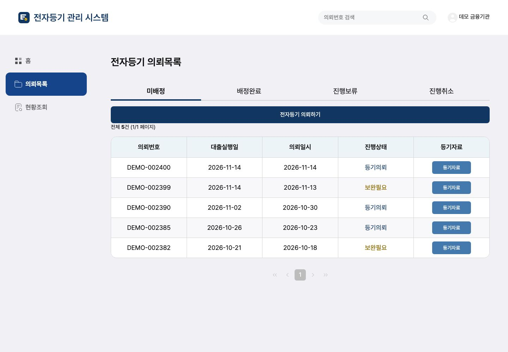
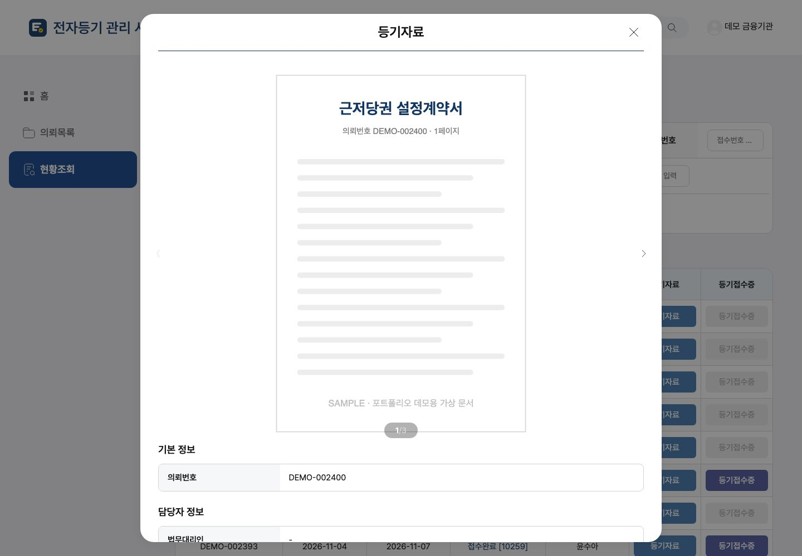
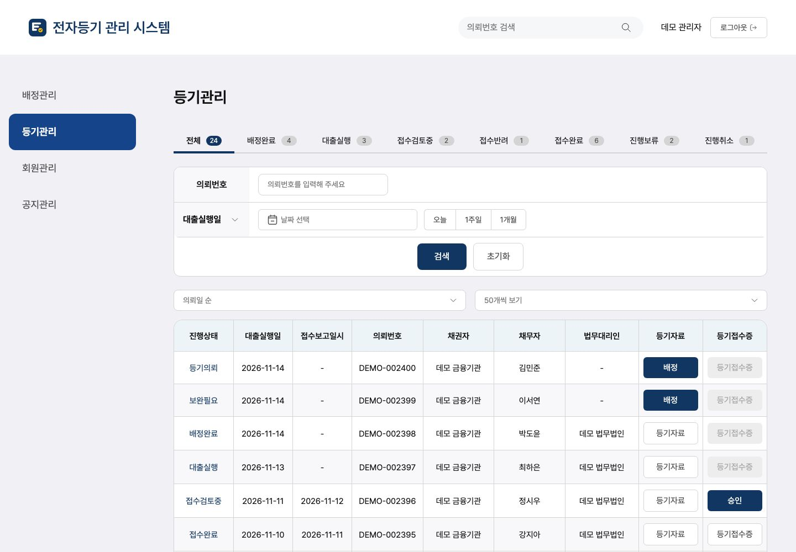
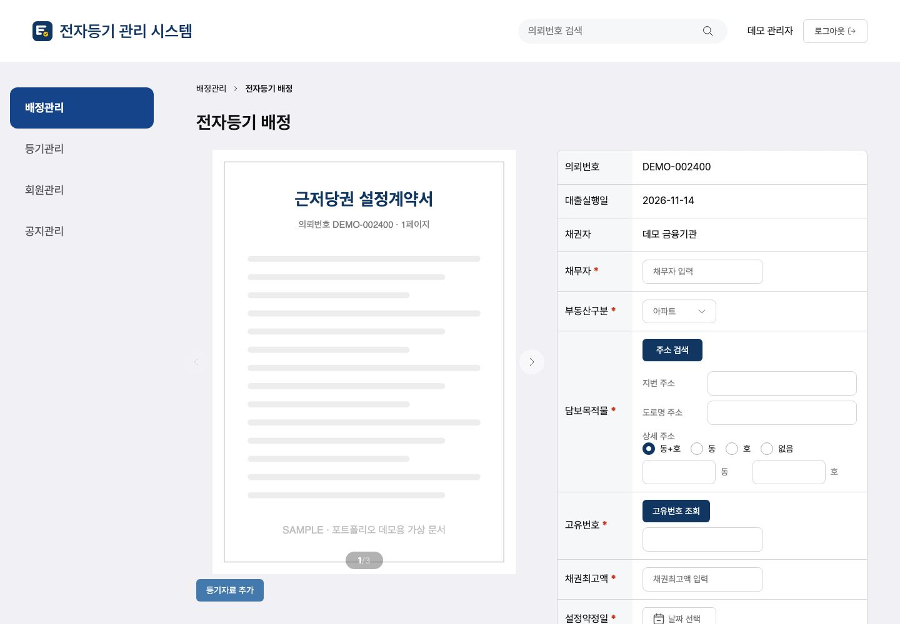
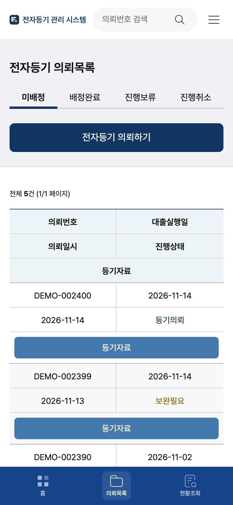

# cERS - 전자등기 관리 시스템

[](https://github.com/ryushin01/cERS/actions/workflows/ci.yml)


금융기관·관리자용 부동산 전자등기 관리 웹 애플리케이션의 프론트엔드입니다. **cERS**는 **c**ore **E**lectronic **R**egistration **S**ystem의 줄임말입니다.

**[데모 바로 보기](https://ers-ryushin01.vercel.app/)** · 로그인 화면에서 사용자 유형을 고르고 버튼만 누르면 됩니다.

> **프로젝트 상태:** 진행이 중단된 프로토타입을 정리한 **포트폴리오 프로젝트**입니다. 백엔드 없이 목업 API로 동작하고, 화면의 모든 데이터는 가상 데이터입니다. 고객사 정보·연락처·로고·샘플 문서는 제거하거나 예시 값으로 바꾸었습니다.

## 화면

화면의 기관, 채무자, 의뢰, 주소는 모두 목업 데이터입니다.

### 금융기관

| 홈 | 의뢰목록 |
|---|---|
|  |  |

| 등기자료 팝업 | 로그인 |
|---|---|
|  |  |

### 관리자

| 등기관리 | 전자등기 배정 |
|---|---|
|  |  |

### 모바일과 Storybook

| 모바일 홈 | 모바일 의뢰목록 | Storybook |
|---|---|---|
|  |  |  |

## 주요 기능

**금융기관**

| 메뉴 | 내용 |
|---|---|
| 홈 | 오늘 실행·진행중·접수완료 통계, 실시간 등기현황, 공지사항 |
| 의뢰목록 | 미배정 / 배정완료 / 진행보류 / 진행취소 탭, 보완필요 사유 팝업, 전자등기 의뢰(파일 업로드)·수정 |
| 현황조회 | 의뢰번호·진행상태·접수번호·채무자·기간 검색, 등기자료·등기접수증 팝업 |
| 공지사항 | 목록, 긴급 공지 표시, 첨부파일 다운로드 |

**관리자**

| 메뉴 | 내용 |
|---|---|
| 배정관리 | 전자등기 신규 등록, 배정(법무대리인 지정)·보완요청·진행취소 |
| 등기관리 | 진행상태별 탭과 건수, 기간 검색, 등기관리 상세, 접수정보 등록, 등기접수증 승인·반려 |

관리자가 처리한 결과는 금융기관 화면에도 그대로 반영됩니다. 회원관리·공지관리·법무대리인 화면은 미구현입니다.

## 기술 스택


| 구분 | 사용 기술 |
|---|---|
| 프레임워크 | Next.js 16 (App Router), React 19, TypeScript |
| 상태·데이터 | TanStack Query v5, jotai, axios, js-cookie |
| 스타일·UI | Tailwind CSS 3, antd(파일 업로드), swiper, react-datepicker |
| 품질 | ESLint(import 정렬), Prettier, husky + lint-staged, Vitest + React Testing Library, fast-check, Storybook 스토리 테스트(Vitest 브라우저 모드 + Playwright, axe 접근성 검사), E2E 테스트(Playwright) |
| 문서 | Storybook 10 (`@storybook/nextjs-vite`) |
| 배포 | Vercel(데모), Docker(standalone), GitHub Actions |

## 시작하기

Node.js 22(`.nvmrc`)와 pnpm 9가 필요합니다.

```bash
nvm use
corepack enable pnpm
pnpm install
pnpm run dev    # https://localhost:4000
```

자체 서명 인증서라 보안 경고가 뜨면 **고급 → localhost(으)로 이동**을 선택하세요. 로그인 화면에서 사용자 유형(금융기관·관리자)을 고르고, 아이디·비밀번호 없이 **로그인**을 누르면 됩니다.

| 명령 | 설명 |
|---|---|
| `pnpm run build` | Storybook을 포함한 프로덕션 빌드 |
| `pnpm run storybook` | Storybook 개발 서버 (`http://localhost:6006`) |
| `pnpm run lint` / `typecheck` | ESLint / 타입 검사 |
| `pnpm test` | 단위·통합 테스트 |
| `pnpm run test:storybook` | 모든 스토리 렌더링과 접근성 검사 |
| `pnpm run test:e2e` | 프로덕션 빌드의 실제 화면 검사 (먼저 `build` 필요) |

전체 명령과 환경 변수는 [개발 가이드](docs/development.md)를 참고하세요.

## 프로젝트 구조

```
.storybook/      Storybook 설정
docker/          개발·운영 Dockerfile
docs/            문서
e2e/             E2E 테스트 (레이아웃·접근성·키보드·업무 흐름·Storybook)
public/          아이콘, 이미지, 로고
src/
├─ app/          라우팅 (금융기관·관리자·법무대리인)
├─ components/   공통·화면 컴포넌트 (옆에 *.stories.tsx, *.test.tsx)
├─ constants/    경로, 코드, 환경 변수
├─ hooks/        공통 훅
├─ mocks/        데모 목업 데이터와 axios 어댑터
├─ services/     API 요청
├─ stores/       전역 상태 (jotai)
├─ styles/       스타일
├─ types/        공용 타입
├─ utils/        유틸리티
└─ proxy.ts 사용자 유형별 접근 제어
```

## 문서

| 문서 | 내용 |
|---|---|
| [개발 가이드](docs/development.md) | 전체 구조, 환경 변수, 프론트엔드 기준, import·코드 규칙, 단위·E2E 테스트 |
| [데모 모드](docs/demo-mode.md) | 목업 API와 데이터 동작 |
| [Storybook](docs/storybook.md) | 구성, 스토리 테스트, 배포, 바로 가기 버튼 |
| [CI · Docker](docs/ci-docker.md) | GitHub Actions, Dependabot, Docker |
| [에디터 설정](docs/editor-setup.md) | IntelliJ, VS Code |
| [시퀀스 다이어그램](docs/sequence-diagrams.md) | 로그인과 화면 이동, API 요청 경로(목업 어댑터), 관리자 배정 등록 |
| [버전 기록](CHANGELOG.md) | 버전별 변경 내용 |
